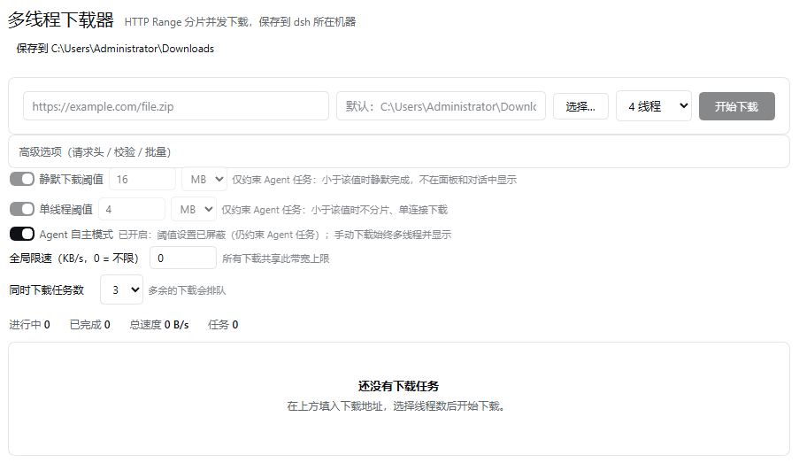
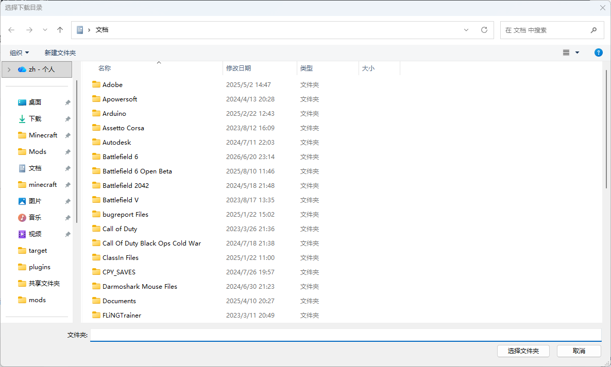

# 市场信息

- **名称**：多线程下载器（Multithread Downloader）
- **包名**：`dsh-multithread-downloader`
- **一句话**：在 DSH 里用 HTTP Range 分片并发下载文件，带面板、对话进度条和 Agent 工具。
- **分类**：工具 / 下载
- **图标**：`icon.svg`
- **仓库**：https://github.com/NONON01/dsh-multithread-downloader

## 描述

Host 端分片并发下载到本机，支持断点续传（ETag/Last-Modified 指纹复核 + If-Range）、自定义请求头、镜像回退、批量 URL、五种算法校验（md5/sha1/sha256/sha512/crc32）、全局限速与全局连接预算。自适应：按设备 CPU/内存负载收缩并发、按站点风控降档并单独限速（不同站点互不影响）。Web GUI 提供侧边栏面板、对话进度条、设置卡片与速度曲线；Agent 通过 `downloader` 工具使用，小文件可静默下载。另附 `doh_lookup`（DoH 解析）与 `http_probe`（只发 HEAD 探测大小/Range/ETag），两者不占下载连接。

## 权限说明

- 网络：访问用户提供的 HTTP/HTTPS 地址
- 文件：写入用户选择的保存目录；读取目标目录可用空间
- 本地接口：`/api/mtd/*` 仅监听 loopback，并校验 Host/Origin

## 非目标

FTP/SFTP、BT/磁力、浏览器接管、代理、HLS/DASH。

## 截图

### 面板

### 目录选择器

### 对话进度条

