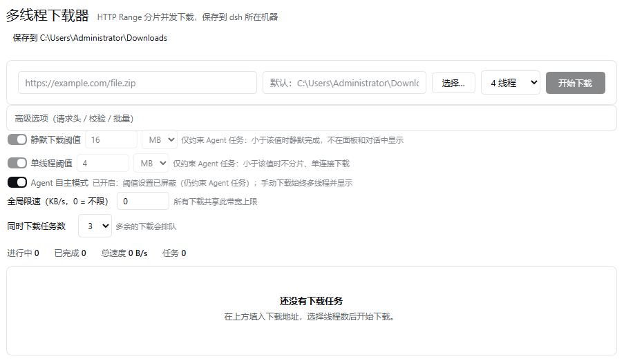

# 多线程下载器（DSH 插件）完整说明

> 版本：1.1.2  
> 仓库：https://github.com/NONON01/dsh-multithread-downloader  
> npm：https://www.npmjs.com/package/dsh-multithread-downloader  
> 最低 DSH：`>=0.2.1-rc.2`；最低 Node：`>=22`

---

## 目录

1. [简介](#简介)
2. [功能总览](#功能总览)
3. [安装与升级](#安装与升级)
4. [界面说明](#界面说明)
5. [用户手动下载](#用户手动下载)
6. [Agent 下载与自主模式](#agent-下载与自主模式)
7. [阈值与显示规则](#阈值与显示规则)
8. [设置项](#设置项)
9. [DoH 解析模式](#doh-解析模式)
10. [GitHub 模式](#github-模式)
11. [请求头、校验、镜像与批量](#请求头校验镜像与批量)
12. [断点续传与任务持久化](#断点续传与任务持久化)
13. [Agent 工具 API](#agent-工具-api)
14. [本地 HTTP API](#本地-http-api)
15. [文件与路径](#文件与路径)
16. [安全说明](#安全说明)
17. [限制与非目标](#限制与非目标)
18. [故障排查](#故障排查)
19. [开发与测试](#开发与测试)
20. [版本与发布](#版本与发布)

---

## 简介

这是一个运行在 DeepSeek Harness（DSH）里的 HTTP/HTTPS 文件下载器。

它同时提供三种使用方式：

- **Web GUI 面板**：新建下载、查看任务、暂停/续传/取消
- **对话输入框上方的进度条**：显示进行中的下载
- **Agent 工具 `downloader`**：模型可以直接创建和管理下载任务

下载由 DSH Host 执行，文件写入 Host 所在机器，不需要浏览器保持页面打开。



---

## 功能总览

- HTTP/HTTPS Range 分片并发下载，单任务最多 16 连接
- 断点续传：暂停/恢复、ETag/Last-Modified 校验、Range 被忽略时自动回退单连接
- 未完成任务持久化，插件重载/DSH 重启后恢复为暂停状态
- 自定义请求头：Cookie / Referer / Authorization 等
- 401/403 给出明确提示
- 分片重试：指数退避，响应头超时 30 秒
- 镜像回退、批量 URL
- 可选 SHA-256 校验、下载前磁盘空间检查
- 全局限速（默认 100 MB/s）与同时任务数（默认 3）
- 可选 DoH 解析（Cloudflare / AliDNS / Tencent）
- GitHub Release 直链自动转 API 资产链接
- `forceDisplay` 强制显示低于静默阈值的任务，并显示速度曲线
- 面板、侧边栏未完成计数、对话进度条、速度曲线
- Windows Known Folder 默认目录、系统原生目录选择器

---

## 安装与升级

### 从 npm 安装

```bash
npm i dsh-multithread-downloader
```

或在 DSH 插件管理里安装 bundle：

```text
dsh-multithread-downloader
```

### 本地开发安装

在 DSH 插件管理里选择本地目录 / `link:` 安装：

```text
link:F:\DSH_Work\multithread-downloader
```

### 升级

- npm 安装：重新安装新版本，或在插件管理里执行更新
- 本地 link：直接更新目录内容后重载插件
- 设置和任务记录保存在 profile 目录，升级不会丢失

安装/重载后，如果页面仍显示旧界面，刷新一次浏览器页面。

---

## 界面说明

### 侧边栏面板

- 新建下载：URL、保存目录、线程数、开始下载
- 高级选项：请求头、SHA-256、批量 URL
- 设置：静默阈值、单线程阈值、Agent 自主模式、DoH、GitHub 模式、全局限速、同时任务数
- 任务列表：状态、进度、速度、大小、操作按钮
- 大文件任务显示速度曲线

### 对话进度条

位于输入框上方，显示：

- 文件名
- 已下载 / 总大小
- 百分比
- 当前速度
- 分段进度条（多任务时按任务大小切段）
- 收起/恢复按钮

### 侧边栏计数

图标角标显示未完成任务数（排队/解析/下载/暂停）。

---

## 用户手动下载

在面板里手动填 URL、目录、线程数并提交，视为**用户手动下载**：

- 始终显示在面板和对话进度条
- 始终按所选线程数分片（选 1 线程则单连接）
- 不受静默阈值、单线程阈值影响
- 不受 Agent 自主模式影响

---

## Agent 下载与自主模式

Agent 通过 `downloader` 工具创建的任务视为 **Agent 下载**：

- 默认受静默阈值和单线程阈值约束
- Agent 自主模式开启时，Agent 可以用 `threads` / `singleThread` 指定自己的策略
- 可用 `forceDisplay: true` 强制显示低于静默阈值的任务
- 可用 `doh: true` / `github: true` 为单个任务启用对应模式

### Agent 自主模式

- 默认开启
- 开启后面板上的静默阈值、单线程阈值设置会被置灰，但数值仍继续约束 Agent 任务
- 用户手动下载不受影响
- 可随时在面板关闭

---

## 阈值与显示规则

### 静默阈值

- 默认开启，16 MB，单位 KB/MB/GB
- 仅约束 Agent 任务
- 小于阈值：任务照常下载，但不进入面板、对话条、侧边栏计数
- 大于等于阈值：显示任务并记录速度采样
- `forceDisplay: true` 可覆盖此规则
- 关闭开关后显示所有任务

### 单线程阈值

- 默认开启，4 MB，单位 KB/MB
- 仅约束 Agent 任务
- 小于阈值：单连接下载（仍使用 Range，支持续传）
- 关闭开关后 Agent 任务也不做尺寸降级
- `singleThread` 显式参数优先

### 曲线显示条件

满足任一条件时显示速度曲线：

- 任务总大小 ≥ 静默阈值
- 任务设置了 `forceDisplay: true`

---

## 设置项

| 设置 | 默认 | 范围 / 说明 |
|---|---|---|
| 静默下载阈值 | 16 MB | 1 KB–10 GB；可开关 |
| 单线程阈值 | 4 MB | 0–10 GB；可开关 |
| Agent 自主模式 | 开启 | 阈值设置置灰但继续生效 |
| DoH 解析 | 关闭 | Cloudflare / AliDNS / Tencent |
| GitHub 模式 | 关闭 | GitHub Release 直链转 API 资产 |
| 全局限速 | 100 MB/s | 0 表示不限 |
| 同时下载任务数 | 3 | 1–8，超出排队 |

设置保存在 profile 目录的：

```text
multithread-downloader.json
```

当前配置版本：9。

---

## DoH 解析模式

DoH（DNS over HTTPS）把 DNS 查询封装在 HTTPS 中，用于绕过被污染的本地 DNS。

### 使用方式

- 面板开关「DoH 解析」，开启前会弹出风险确认
- 选择提供商：
  - Cloudflare：`https://cloudflare-dns.com/dns-query`
  - AliDNS：`https://dns.alidns.com/resolve`
  - Tencent：`https://doh.pub/dns-query`
- Agent 可按任务启用：

```json
{ "doh": true, "dohProvider": "alidns" }
```

### 行为

- 只影响下载器的 DNS 解析
- 不改系统 DNS、不改 hosts
- TLS 仍按原域名校验，SNI 不变
- DoH 查询失败时回退系统 DNS
- 默认关闭

### 风险

- DNS 查询会发送给所选第三方
- 提供商可能返回错误结果
- 某些网络中 Cloudflare DoH 不可达，可改用 AliDNS / Tencent

---

## GitHub 模式

用于绕过 `github.com` 被 DNS 污染的情况。

### 使用方式

- 面板开关「GitHub 模式」，默认关闭
- Agent 可按任务启用或覆盖：

```json
{ "github": true }
```

### 行为

识别：

```text
https://github.com/<owner>/<repo>/releases/download/<tag>/<file>
```

自动：

1. 调用 `api.github.com` 查询 release asset
2. 改用 `https://api.github.com/repos/<owner>/<repo>/releases/assets/<id>`
3. 附加 `accept: application/octet-stream`

非 GitHub Release 链接不受影响。

### 注意

- 使用 GitHub API 未认证额度（约 60 次/小时）
- 私有仓库暂不支持
- 只处理 Release 下载直链，不处理源码页面/压缩包页面

---

## 请求头、校验、镜像与批量

### 请求头

- 工具参数：`headers` 对象
- 面板：高级选项里按 `Key: value` 每行填写
- 禁止覆盖 `range`、`host`、`content-length`、`connection`、`accept-encoding`
- 401/403/407 会提示需要提供 Cookie / Referer / Authorization
- 请求头会随未完成任务以**明文**保存在 profile 目录

### SHA-256

- 工具参数：`sha256`
- 完成后流式计算校验
- 不匹配则任务失败，保留 `.mtd-part`

### 镜像

- 工具参数：`mirrors` 数组
- 主地址失败或分片出错时轮换重试

### 批量

- 工具参数：`urls` 数组，最多 20 个
- 面板：高级选项里每行一个 URL
- 批量时忽略 `filename`，由响应头/URL 推断

### 重试与超时

- 每分片最多 4 次尝试
- 指数退避，最长 8 秒
- 遵循 `Retry-After`
- 响应头超时 30 秒
- 可重试状态：408 / 425 / 429 / 500 / 502 / 503 / 504
- 不重试：401/403 等客户端错误、非标准 5xx（如 567）

---

## 断点续传与任务持久化

### 暂停/恢复

- 暂停保留 `.mtd-part` 分片文件
- 恢复前重新探测远端大小、ETag、Last-Modified
- 远端变化则放弃旧分片，从头下载
- 服务器忽略 Range 时自动降级为单连接重下

### 重启恢复

未完成任务写入：

```text
multithread-downloader-tasks.json
```

插件重载/DSH 重启后恢复为 **paused** 状态，分片游标保留，可手动/工具恢复。

完成、取消、失败的任务不会恢复。

---

## Agent 工具 API

工具名：`downloader`

### 参数

| 参数 | 类型 | 说明 |
|---|---|---|
| `action` | string | `add` / `list` / `pause` / `resume` / `cancel` / `remove` / `clean` |
| `url` | string | 单个下载地址 |
| `urls` | string[] | 批量地址，最多 20 |
| `mirrors` | string[] | 备用镜像 |
| `directory` | string | 保存目录，省略用默认目录 |
| `filename` | string | 保存文件名 |
| `threads` | int | 1–16 |
| `singleThread` | bool | 强制单连接/分片 |
| `headers` | object | 自定义请求头 |
| `sha256` | string | 64 位十六进制校验值 |
| `doh` | bool | 该任务启用 DoH |
| `dohProvider` | string | `cloudflare` / `alidns` / `tencent` |
| `github` | bool | 该任务启用 GitHub 模式 |
| `forceDisplay` | bool | 覆盖静默阈值强制显示 |
| `id` | string | 控制任务时的任务 ID |
| `limit` | int | `list` 返回条数，1–100，默认 20 |

### 示例

```json
{
  "action": "add",
  "url": "https://example.com/file.zip",
  "directory": "D:\\Downloads",
  "threads": 8,
  "headers": { "Referer": "https://example.com/" },
  "sha256": "…"
}
```

```json
{ "action": "add", "url": "https://github.com/owner/repo/releases/download/v1/file.exe", "github": true }
```

```json
{ "action": "add", "url": "https://example.com/small.bin", "forceDisplay": true }
```

```json
{ "action": "pause", "id": "a1b2c3d4" }
```

```json
{ "action": "list", "limit": 10 }
```

### 任务状态

`queued` / `probing` / `downloading` / `paused` / `completed` / `failed` / `canceled`

### 返回值

- 单个任务：`{ ok, action, task }`
- 批量：`{ ok, action, tasks }`
- `list` 会附加 `visibleInUi`

---

## 本地 HTTP API

前缀：`/api/mtd`

仅接受本机 loopback + 同源请求。

| 路由 | 方法 | 说明 |
|---|---|---|
| `/state` | POST | 面板任务、设置、统计 |
| `/add` | POST | 新建下载（`origin=user`） |
| `/control` | POST | `pause/resume/cancel/remove` |
| `/settings` | POST | 更新设置 |
| `/summary` | POST | 侧边栏/进度条汇总 |
| `/browse` | POST | 目录浏览 |
| `/pick-directory` | POST | 调用系统原生目录选择器 |

示例：

```bash
curl -X POST http://127.0.0.1:60437/api/mtd/add \
  -H 'content-type: application/json' \
  -d '{"url":"https://example.com/a.zip","threads":8}'
```

---

## 文件与路径

### 默认下载目录

优先级：

1. 配置 `directory`
2. Windows Downloads Known Folder
3. Linux `XDG_DOWNLOAD_DIR`
4. macOS `~/Downloads`
5. 用户主目录下的 `Downloads` 回退

Windows 支持被重定向到 OneDrive/其他盘。

### 目录选择器

- Windows：随包 `bin/picker.exe`，调用 `IFileOpenDialog`
- macOS：`osascript`
- Linux：`zenity` / `kdialog`
- 失败回退插件内目录浏览器

### 临时文件

下载中的文件为：

```text
<目标文件>.mtd-part
```

取消会删除；暂停/失败保留。

---

## 安全说明

- 本地 API 仅监听 loopback，并校验 Host/Origin
- 跨域重定向时剥离 Cookie / Authorization / Proxy-Authorization
- 请求头会明文保存在 profile，敏感 Cookie 请自行评估
- 插件可向用户指定目录写文件；不要对不可信 Agent 开放任意路径
- DoH 会把 DNS 查询交给第三方，失败会回退系统 DNS
- `bin/picker.exe` 未签名，Windows 可能触发 SmartScreen
- 不接管浏览器登录态，不自动读取 Cookie

---

## 限制与非目标

只支持 HTTP/HTTPS 直链。

明确不支持、也不会实现：

- FTP / SFTP
- BT / 磁力 / Metalink
- 浏览器扩展接管、自动登录态
- 系统代理 / 自定义代理
- HLS / DASH 流媒体

其他限制：

- GitHub API 未认证额度有限
- 非标准 5xx（如 567）不会重试
- DoH 提供商可能不可达
- 私有 GitHub 仓库不支持
- 无代码签名

---

## 故障排查

### 401 / 403 / 407

提供请求头：

```json
{ "headers": { "Cookie": "…", "Referer": "https://…" } }
```

### GitHub 直链 `fetch failed`

本机 `github.com` 可能被 DNS 污染：

- 开启 GitHub 模式
- 或启用 DoH
- 或使用 `api.github.com/.../releases/assets/<id>`

### 非标准 5xx（如 567）

通常是 CDN 限流：

- 降低线程数
- 降低全局限速
- 等待冷却后重试

### 曲线不显示

- 任务大小低于静默阈值且未设置 `forceDisplay`
- 历史采样不足（刚创建/完成太快）
- 页面未刷新到新客户端

### 速度远低于限速

全局限速是上限，不是保底；实际速度受服务器/网络/连接数限制。

### 页面仍显示旧界面

刷新浏览器页面；客户端插件更新不一定自动热加载。

---

## 开发与测试

```bash
npm test
npm pack --dry-run
```

测试覆盖：

- 请求头清洗
- 重试退避
- 限速器
- 探测/401 提示
- 跨域重定向剥离敏感头
- SHA-256
- GitHub Release URL 解析
- DoH 提供商归一化

CI：GitHub Actions，Node 22 / 24，Linux / Windows / macOS。

---

## 版本与发布

- 当前版本：**1.1.2**
- npm：`latest = 1.1.2`
- GitHub Release：`v1.1.2`
- 历史版本：
  - 1.1.1：修正 Node 最低版本
  - 1.1.0：DoH 与 GitHub 模式
  - 1.0.4：默认限速 100 MB/s
  - 1.0.3：DSH 0.2.2 兼容性标记
  - 1.0.2：DSH 0.2.1-rc.5 兼容性
  - 1.0.1：CI 修复
  - 1.0.0：首个发布版本

---

## 相关文件

- `README.md`：快速开始
- `CHANGELOG.md`：版本记录
- `SECURITY.md`：安全说明
- `PUBLISHING.md`：发布清单
- `MARKETPLACE.md`：市场信息
- `docs/screenshots/`：界面截图
- `bin/picker.cs` / `bin/picker.exe`：Windows 目录选择器
